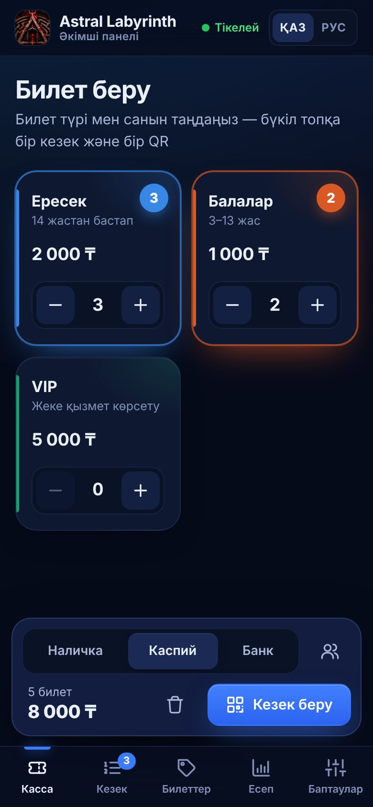
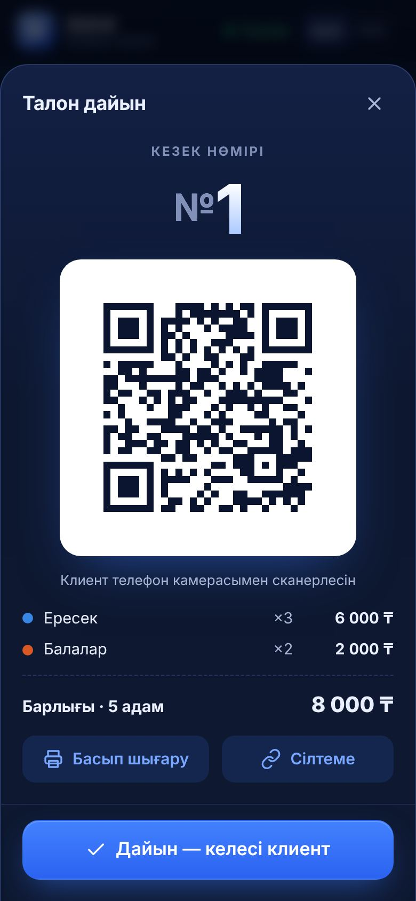
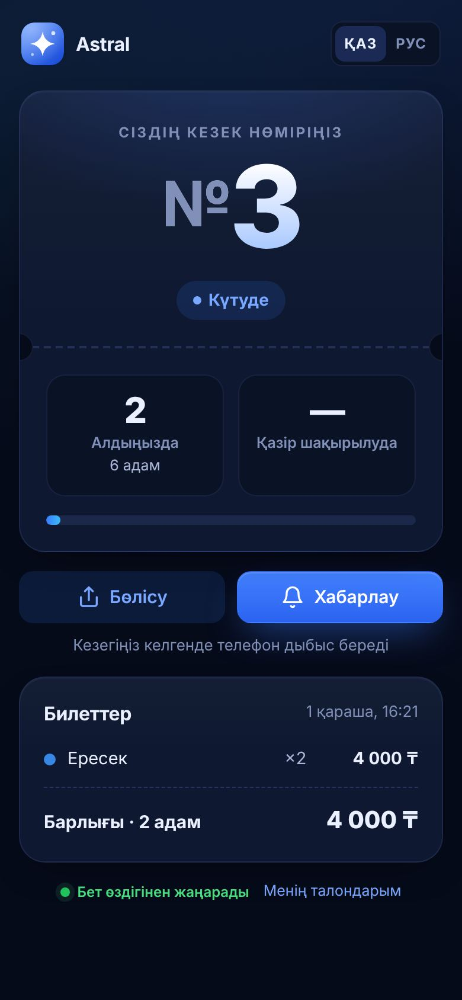
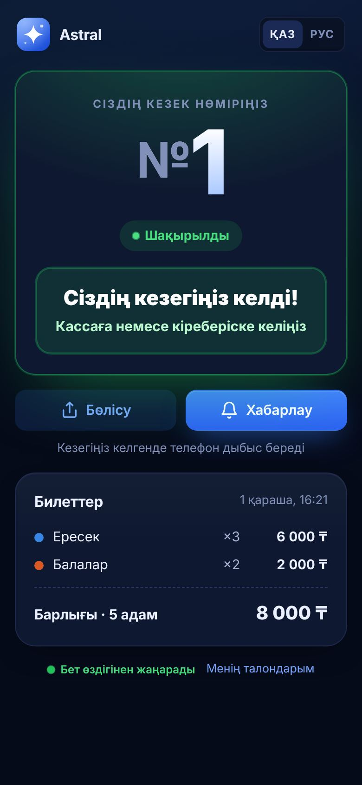
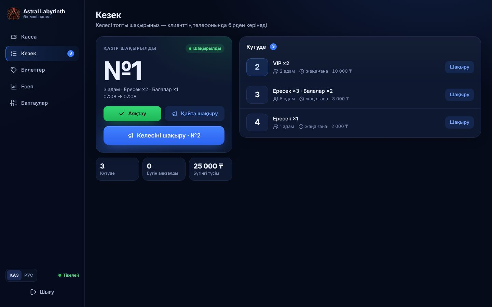
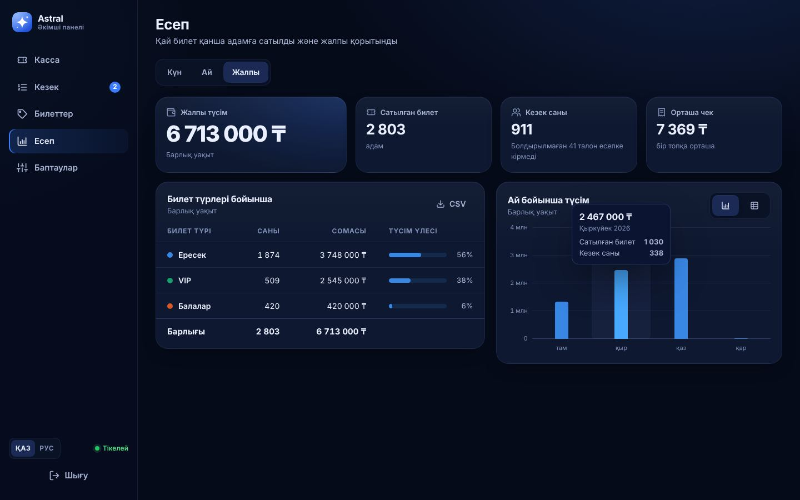
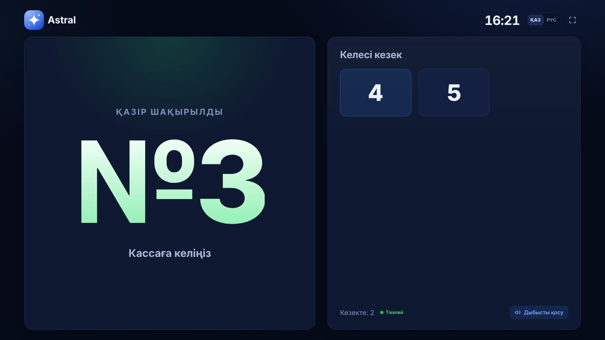

# Astral — электронды кезек және талон жүйесі

Кассир (әкімші) клиентке билет береді → экранда **QR код** шығады → клиент телефонымен сканерлейді
және **өз кезегін тікелей көреді**. Бір топқа (мысалы 5 адам, әртүрлі билеттер) — **бір кезек, бір QR**.
Есеп бетінде күндік / айлық / жалпы сату қорытындысы.

Телефонға **қосымша ретінде орнатылады** (PWA): браузерден ашып, «Басты экранға қосу».

**Интернетке тегін шығару (кез келген жерден, кез келген браузерден ашу)** — бір түйме, карта керек емес:
[](https://deploy.workers.cloudflare.com/?url=https://github.com/Gitbyzhn/astral_lk)
— толығырақ [төмендегі нұсқаулықта](#интернетке-шығару).

| Касса | Талон + QR | Клиент телефоны | Кезегі келгенде |
|---|---|---|---|
|  |  |  |  |

| Кезек (әкімші) | Есеп / дашборд |
|---|---|
|  |  |



---

## Мүмкіндіктер

**Әкімші / диспетчер** (`/admin`): құпиясөзбен немесе **әкімші сілтемесімен** (`/admin#key=…`) —
сілтемені ашқан құрылғы аккаунтсыз, құпиясөзсіз кіреді. Сілтемені «Баптаулар» бетінен көшіріп немесе
QR арқылы қызметкердің планшетіне/телефонына ашасыз; «Жаңа сілтеме» ескісін өшіріп, барлық құрылғыларды шығарады.

- **Билет түрлері** — атауы, бағасы (₸), сипаттамасы, түсі. Қалағаныңызша көп түр; кассада көрсету/жасыру, ретін өзгерту.
- **Касса** — әр билет түрінің санын көрсетесіз (мысалы: 3 «Ересек» + 2 «Балалар»), «Кезек беру» → кезек нөмірі және QR.
  Талонды чек принтерге (58/80 мм) басып шығаруға немесе сілтемесін жіберуге болады.
- **Кезек** — «Келесіні шақыру» бір түймемен: алдыңғы топ аяқталады, келесісі шақырылады.
  Қайта шақыру, талонды болдырмау, кезекке қайтару. Кезек нөмірі күн сайын 1-ден басталады.
- **Есеп** — күн / ай / барлық уақыт: жалпы түсім, сатылған билет саны, кезек (топ) саны, орташа чек,
  әр билет түрі бойынша сан мен сома, сағат/күн/ай бойынша график. CSV-ге жүктеу.
- **Баптаулар** — мекеме атауы, құпиясөзді өзгерту, залға арналған табло.

**Клиент** (QR арқылы ашылады, тіркелусіз)

- Кезек нөмірі, «алдыңызда N топ», қазір кім шақырылуда — **өздігінен жаңарады** (бетті жаңарту керек емес).
- Кезегі келгенде: жасыл «Сіздің кезегіңіз келді!», дыбыс және діріл (Android-та хабарлама да).
- Топтағы кез келген адам сол QR-ды сканерлей алады немесе сілтемемен «Бөлісу».
- «Менің талондарым» — сканерленген талондар телефонда сақталады.

**Табло** (`/board`) — теледидарға/мониторға: қазір шақырылған нөмір ірі, келесі нөмірлер, дыбыс.

Интерфейс **қазақша және орысша** (ауыстырғыш әр бетте).

---

## Жылдам іске қосу (өз компьютеріңізде)

Қажет: **Node.js 22+** ([nodejs.org](https://nodejs.org)).

```bash
npm install
npm start
```

Терминалда мекенжайлар шығады:

```
  • Клиент:  http://192.168.1.15:3000
    Әкімші:  http://192.168.1.15:3000/admin
```

- Әкімші беті: `http://<компьютер-IP>:3000/admin`, әдепкі құпиясөз: **`admin`** (бірден «Баптаулар» бетінде өзгертіңіз).
- Телефондар **сол Wi-Fi** желісінде болса, QR бірден жұмыс істейді.
- ⚠️ Әкімші бетін `localhost` арқылы ашсаңыз, QR-дағы сілтеме клиенттің телефонында ашылмайды —
  компьютердің IP мекенжайын қолданыңыз (бағдарлама өзі ескертеді).

> Телефонға **қосымша ретінде орнату** және хабарламалар үшін сайт **HTTPS** арқылы ашылуы керек
> (браузер талабы). Төмендегі [«Интернетке шығару»](#интернетке-шығару) бөлімін қараңыз.

---

## Телефонға қосымша ретінде орнату

- **Android (Chrome):** сайтты ашыңыз → мәзір ⋮ → **«Қосымшаны орнату» / «Басты экранға қосу»**.
  Әкімші бетінде «Баптаулар» → «Қосымшаны орнату» түймесі де бар.
- **iPhone (Safari):** «Бөлісу» ⬆️ → **«Басты экранға қосу» (На экран «Домой»)**.

Екі бөлек қосымша орнатылады: әкімшіге **«Касса»** (`/admin`), клиентке **«Кезек»** (`/`).
Атауы «Баптаулардағы» мекеме атауынан алынады.

---

## Claude сілтемесі нұсқасы (серверсіз)

Бағдарламаның бір HTML файлдан тұратын нұсқасы Claude-та сілтемемен ашылады — хостинг, домен, төлем
керек емес. Деректер Claude-тың сол бетке арналған деректер базасында сақталады.

- **Әкімші (иесі)** — Claude-қа кірген күйде сілтемені ашады: касса, кезек, билет түрлері, есеп, баптаулар.
  Бұл нұсқада әкімші **міндетті түрде Claude аккаунтымен** кіреді: Claude деректерді тек иесіне сақтатады,
  ал бет сыртқы серверге қосыла алмайды. Аккаунтсыз «әкімші сілтемесі» керек болса — толық нұсқаны
  төмендегі «Интернетке шығару» бойынша орнатыңыз.
- **Клиенттер** — Claude аккаунтынсыз: QR сілтемесінде талон мәліметі бар, ал кезектегі орны бетке
  салынған күйден есептеледі. Кезек өзгергенде (шақыру, болдырмау) бет жаңа нұсқа ретінде
  жарияланады да, клиенттің ашық беті өздігінен жаңарады (20–30 секунд ішінде).

Бір рет баптау:

1. Сілтемені ашып, **Share** арқылы жария сілтеме (Public link / Anyone with the link) қосыңыз —
   әйтпесе клиенттер бетті ашпайды.
2. **Copy link** басып, «Баптаулар» → «Клиенттерге арналған сілтеме» өрісіне қойып, **Сақтау**.
   QR осы сілтемемен жасалады.

Шектеулері (Claude беттің ішінде рұқсат етпейді): талонды басып шығару, телефонға қосымша ретінде
орнату, клиент телефонындағы дыбыс/хабарлама. Кезек жаңартылған сәтте әкімші беті де бір-екі секундқа
қайта жүктеледі (терезе ашық тұрғанда немесе касса толтырылып жатқанда күтеді). Бұлардың бәрі толық
нұсқада бар — төмендегі «Интернетке шығару».

Әзірлеушіге: `npm run build:artifact` → `dist/astral-artifact.html`. Ортақ беттер өзгеріссіз алынады,
тек деректер қабаты ауыстырылады (`artifact/`: Claude db, #hash маршрутизатор, бетті жариялау).
Бастапқы мысал билет түрлері — `artifact/seed.json`.

## Интернетке шығару

Бағдарламаның сервер бөлігі бар (деректер базасы, нақты уақыттағы кезек), сондықтан жүктелген
файлдарды жай ғана ашу жеткіліксіз — ол **тәулік бойы қосулы тұратын интернеттегі серверде** жұмыс
істеуі керек. Сонда сайт `https://...` мекенжайымен кез келген телефоннан, кез келген жерден ашылады.

### Тегін: Cloudflare (ұсынылады)

Cloudflare-дің тегін жоспарында: төлем картасы керек емес, сайт ұйықтамайды, деректер тегін D1
базасында сақталады, мекенжайы `https://astral-lk.<сіздің-атыңыз>.workers.dev`. D1 базасы мен кестелер
бірінші орнатуда өздігінен жасалады.

1. [dash.cloudflare.com/sign-up](https://dash.cloudflare.com/sign-up) — email арқылы тегін тіркеліңіз.
2. Мына түймені басыңыз:
   [](https://deploy.workers.cloudflare.com/?url=https://github.com/Gitbyzhn/astral_lk)
3. GitHub аккаунтыңызды қосыңыз (Cloudflare жобаның көшірмесін сіздің GitHub-қа жасайды).
4. **ADMIN_PASSWORD** өрісіне алғашқы құпиясөзді жазып, **Deploy** басыңыз. 2–3 минутта дайын.
5. Сайтты ашыңыз: `…workers.dev/admin` → құпиясөзбен бір рет кіресіз →
   **Баптаулар → «Әкімші сілтемесі»** → оны қызметкерлердің құрылғыларында ашыңыз (аккаунтсыз, құпиясөзсіз).

Репозиторийді Cloudflare-ге түймесіз, тікелей қоссаңыз (Workers & Pages → Create → Import a repository):
Deploy command — `npx wrangler deploy`, алғашқы құпиясөз — **`admin`** (кіргеннен кейін «Баптаулар» бетінде өзгертіңіз).

Бұл нұсқада кезек өзгерістері SSE орнына әр 10 секунд сайын тексеріледі (тегін платформаның ерекшелігі).
Тегін шектеулер (күніне 100 000 сұрау, D1 — 5 млн жол оқу) шағын мекемеге бірнеше есе жетеді.
Код `worker/` бумасында, баптауы — `wrangler.jsonc`. Өз компьютеріңізде сынау: `npm run cf:dev`.

### 1-нұсқа: Render — ақылы, бірақ ең қарапайым толық сервер (~$7/ай)

Ештеңе орнатудың, файл көшірудің қажеті жоқ: Render кодты осы GitHub репозиторийінен өзі алады,
HTTPS мекенжайын өзі береді. Барлық баптау дайын тұр ([`render.yaml`](render.yaml)).

1. [render.com](https://render.com) сайтында **Sign up → GitHub** арқылы тіркеліңіз.
2. Мына түймені басыңыз:
   [](https://render.com/deploy?repo=https://github.com/Gitbyzhn/astral_lk)
   (немесе Render Dashboard → **New → Blueprint** → `Gitbyzhn/astral_lk` репозиторийін таңдаңыз).
3. **ADMIN_PASSWORD** өрісіне әкімші құпиясөзін ойлап жазыңыз.
4. Төлем картасын қосып, **Deploy Blueprint / Apply** түймесін басыңыз. 3–5 минутта дайын болады.
5. Сайтыңыздың мекенжайы Render-де көрсетіледі, мысалы `https://astral-kezek.onrender.com`:
   - әкімші (касса): `https://astral-kezek.onrender.com/admin` — бір рет 3-қадамдағы құпиясөзбен кіресіз;
   - **«Баптаулар» → «Әкімші сілтемесі»** — осы сілтемені (немесе QR-ын) қызметкерлердің құрылғыларында
     ашыңыз: олар аккаунтсыз, құпиясөзсіз кіреді;
   - клиенттер QR арқылы өздері кіреді (аккаунт керек емес); залдағы табло: `/board`.
6. Телефонға қосымша ретінде орнату — [жоғарыдағы бөлім](#телефонға-қосымша-ретінде-орнату).

**Құны:** шамамен **$7/ай** (Starter сервер) + **$0.25/ай** (1 ГБ диск). Нақты бағасын
[render.com/pricing](https://render.com/pricing) бетінен тексеріңіз. Тегін жоспар **жарамайды**: онда тұрақты
диск жоқ (әр жаңартуда барлық билет пен есеп өшеді) және сервер 15 минут бос тұрса «ұйықтап» қалады.

**Өз доменіңіз** (мысалы `kezek.astral.kz`): Render → сервис → **Settings → Custom Domains** → доменді
жазыңыз → домен сатып алған сайтта (ps.kz, hoster.kz, …) Render көрсеткен **CNAME** жазбасын қосыңыз.
HTTPS сертификатын Render өзі береді.

**Жаңарту:** GitHub-тағы кодқа өзгеріс түссе, Render сайтты өзі қайта жариялайды; деректер дискте сақталады.

### 2-нұсқа: Өз серверіңіз (VPS) + Docker

Кез келген Linux сервер (ps.kz, hoster.kz, Hetzner, т.б.) және өз доменіңіз (мысалы `kezek.example.kz`).

1. Доменнің A-жазбасын сервердің IP-іне бағыттаңыз.
2. Серверде: `git clone https://github.com/Gitbyzhn/astral_lk.git && cd astral_lk`
3. `docker-compose.yml` ішінде `PUBLIC_URL` және `ADMIN_PASSWORD` мәндерін өзгертіп, іске қосыңыз:

   ```bash
   docker compose up -d --build
   ```

4. HTTPS үшін ең оңай жол — [Caddy](https://caddyserver.com) (сертификатты өзі алады). `/etc/caddy/Caddyfile`:

   ```
   kezek.example.kz {
       reverse_proxy localhost:3000
   }
   ```

   `sudo systemctl reload caddy` — болды, сайт `https://kezek.example.kz` мекенжайында.

### 3-нұсқа: Docker-сіз (Node.js + pm2 + nginx)

```bash
git clone https://github.com/Gitbyzhn/astral_lk.git astral && cd astral
npm ci --omit=dev
PUBLIC_URL=https://kezek.example.kz npx pm2 start server/index.js --name astral
npx pm2 save
```

nginx үшін маңызды: нақты уақыттағы жаңартулар (SSE) буферленбеуі керек.

```nginx
server {
    server_name kezek.example.kz;
    location / {
        proxy_pass http://127.0.0.1:3000;
        proxy_http_version 1.1;
        proxy_set_header Host $host;
        proxy_set_header X-Forwarded-For $proxy_add_x_forwarded_for;
        proxy_set_header X-Forwarded-Proto $scheme;
        proxy_buffering off;          # SSE үшін
        proxy_read_timeout 1h;
    }
}
```

HTTPS: `sudo certbot --nginx -d kezek.example.kz`.

### 4-нұсқа: Railway / Fly.io

Репозиторийді қосыңыз (Dockerfile өзі табылады), **тұрақты диск (volume)** қосып, оны `/data`-ға
бекітіңіз — әйтпесе әр жаңартуда деректер өшеді. Орта айнымалысы: `ADMIN_PASSWORD`.
Диск құқықтарын контейнер өзі реттейді (`docker-entrypoint.sh`), қосымша баптау керек емес.

### Тегін тексеріп көру: өз компьютеріңізден уақытша сілтеме

Сатып алмай тұрып сынап көру үшін: компьютерде `npm start` іске қосылып тұрғанда
[Cloudflare Tunnel](https://try.cloudflare.com)
уақытша `https://….trycloudflare.com` сілтемесін береді — ол кез келген жерден ашылады:

```bash
# Windows: winget install --id Cloudflare.cloudflared    macOS: brew install cloudflared
cloudflared tunnel --url http://localhost:3000
```

Бұл тек сынауға арналған: компьютер өшсе сайт та өшеді, ал сілтеме әр іске қосқанда өзгереді.

---

## Баптаулар (орта айнымалылары)

| Айнымалы | Әдепкі | Сипаттама |
|---|---|---|
| `PORT` | `3000` | Сервер порты |
| `HOST` | `0.0.0.0` | Тыңдайтын интерфейс |
| `PUBLIC_URL` | — | Сайттың мекенжайы (QR осымен жасалады), мысалы `https://kezek.example.kz` |
| `ADMIN_PASSWORD` | `admin` | **Алғашқы** іске қосудағы құпиясөз (кейін «Баптаулар» бетінде өзгертіледі) |
| `APP_TIMEZONE` | `Asia/Almaty` | Уақыт белдеуі: күндік есеп пен кезек нөмірінің нөлденуі осыған байланысты |
| `DATA_DIR` | `./data` | SQLite деректер базасы сақталатын бума |
| `QUEUE_TTL_HOURS` | `12` | Осынша сағаттан ескі, шақырылмаған талондар кезектен автоматты түрде жабылады |
| `SESSION_DAYS` | `30` | Әкімшінің кіру сессиясының мерзімі (күн) |
| `TRUST_PROXY` | `loopback, linklocal, uniquelocal` | Reverse proxy артында клиент IP-ін дұрыс анықтау |

## Күнделікті әкімшілік

```bash
npm run password -- ЖаңаҚұпиясөз   # құпиясөзді ұмытып қалсаңыз (барлық құрылғылардан шығарады)
npm run admin-link                 # әкімші сілтемесін көрсету (--new: жаңасын жасау, ескісі өшеді)
npm run backup                     # сақтық көшірме → data/backups/astral-ГГГГ-АА-КК-ССММ.db
```

Docker-де: `docker compose exec -u node astral npm run backup`. Барлық дерек бір файлда: `data/astral.db`.

---

## Әзірлеушіге

```bash
npm run dev     # файл өзгерсе сервер өзі қайта қосылады
npm test        # API тесттері (node:test)
```

- **Сервер:** Node.js 22, Express 5, SQLite (`better-sqlite3`), Server-Sent Events — сыртқы сервис қажет емес.
- **Тегін нұсқа:** Cloudflare Workers + D1 (`worker/`, `migrations/`, `wrangler.jsonc`) — API жолдары мен
  жауаптары сервер нұсқасымен бірдей, беттер (public/) ортақ.
- **Клиент:** таза JavaScript (ES modules), құрастыру (build) қадамы жоқ, PWA (manifest + service worker).
- **Қауіпсіздік:** құпиясөз scrypt-пен хэштеледі, HMAC токен, кіру әрекеттерін шектеу, қатаң CSP,
  клиент тек өз талонын көреді (сілтемедегі код болжап табылмайды).

```
server/
  index.js            іске қосу
  app.js              маршруттар (API + беттер)
  db.js               SQLite схемасы
  auth.js             құпиясөз, токен
  events.js           нақты уақыттағы хабарлар (SSE)
  services/           билет түрлері, тапсырыстар/кезек, есептер, баптаулар
  cli/                password, backup
public/
  index.html          клиент қосымшасы (/, /t/:код, /board)
  admin/index.html    әкімші қосымшасы (/admin/...)
  assets/css/app.css  дизайн жүйесі (қою көк)
  assets/js/core/     ортақ модульдер: API, i18n (KZ/RU), QR, роутер, UI
  assets/js/admin/    касса, кезек, билет түрлері, есеп, баптаулар
  assets/js/client/   талон беті, басты бет, табло
  sw.js               service worker
worker/               Cloudflare Workers нұсқасы (тегін хостинг): D1 деректер базасы
migrations/           D1 схемасы
test/api.test.js      API тесттері
render.yaml           Render-ге бір рет басып шығару баптауы
Dockerfile            Docker образы (+ docker-entrypoint.sh, docker-compose.yml)
```

### API қысқаша

| Әдіс | Жол | |
|---|---|---|
| `POST` | `/api/auth/login` | `{ password }` → `{ token }` |
| `GET/POST/PATCH/DELETE` | `/api/admin/types[/:id]` | билет түрлері |
| `POST` | `/api/admin/orders` | `{ items: [{ ticketTypeId, qty }] }` → талон (нөмір, код) |
| `GET` | `/api/admin/queue` | кезек күйі |
| `POST` | `/api/admin/queue/next` | келесіні шақыру |
| `PATCH` | `/api/admin/orders/:id` | `{ status: waiting \| serving \| done \| cancelled }` |
| `GET` | `/api/admin/reports?period=day\|month\|all&date=` | есеп |
| `GET` | `/api/public/orders/:code` | клиент талоны + кезектегі орны |
| `GET` | `/api/public/board` | табло |
| `GET` | `/api/events` | SSE ағыны |

---

## Кратко по-русски

Система электронной очереди: администратор выбирает виды билетов и количество (например, 3 «Взрослый» +
2 «Детский») → нажимает «Выдать очередь» → появляется **QR-код**; клиент сканирует его телефоном и видит
свой номер и сколько групп перед ним — страница обновляется сама. Одна группа = одна очередь = один QR.
Отчёты за день / месяц / всё время, табло для зала, интерфейс на казахском и русском, устанавливается
на телефон как приложение (нужен HTTPS).

Запуск: `npm install && npm start`, админка — `/admin`, пароль по умолчанию `admin`.
Бесплатно в интернете: кнопка **Deploy to Cloudflare** (раздел «Интернетке шығару» выше) — без карты,
адрес `https://astral-lk.<ваше-имя>.workers.dev`, данные в бесплатной базе Cloudflare D1. Вход в админку:
пароль один раз, затем «Настройки → Ссылка администратора» (без аккаунта и пароля, как токен в ссылке).
Платные альтернативы: Render (≈ $7/мес) или свой VPS + Docker + Caddy.
